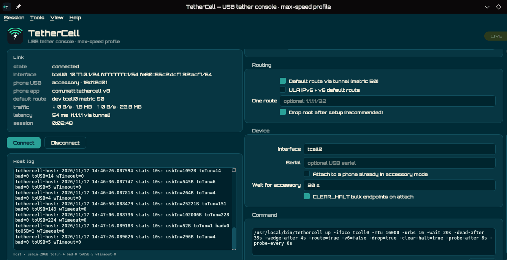
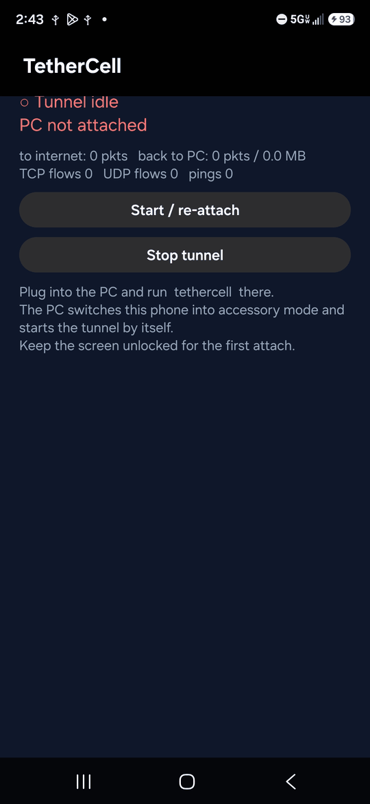
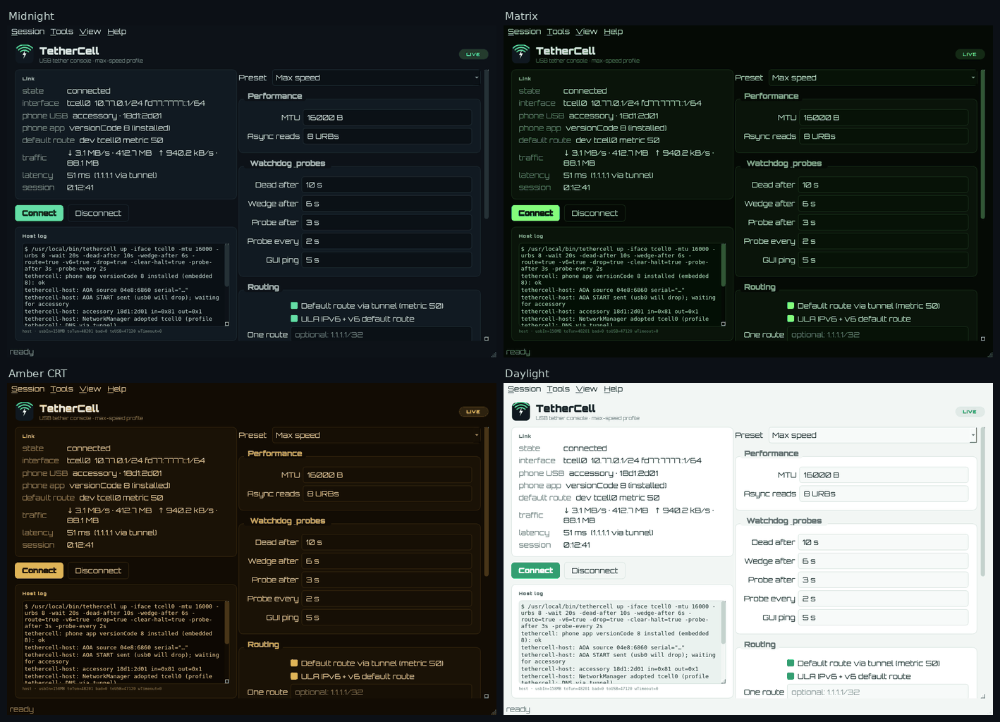

# TetherCell

Own USB reverse tether: Linux desktop <-> Android phone over AOA (manufacturer `mxlab`, model `tethercell`).
The phone app (`com.matt.tethercell`) runs a gVisor netstack and re-dials every flow from its own sockets.

## Try it

```sh
curl -fsSLO https://raw.githubusercontent.com/md3222/tethercell/main/release/install.sh
sh install.sh
```

Then `adb install -r ~/tethercell.apk`, replug the cable, run `tethercell`.
Full walkthrough, tuning and troubleshooting: **[INSTALL.md](INSTALL.md)**.
Releases (binary + APK + SHA256SUMS): <https://github.com/md3222/tethercell/releases>.

Linux x86-64 for the desktop; Android 10+ for the phone; no root on either side.

## Screenshots

| Desktop GUI | Phone app |
|---|---|
|  |  |

Six of the eight palettes under **View** — real captures on a live `tcell0` link:



Individual shots: [`docs/screenshots/themes/`](docs/screenshots/themes) (Midnight, Amber CRT,
Cyberpunk, Daylight, Nord, Matrix). Missing: Solarized and Rosé.


| dir | what |
|---|---|
| `clone/` | desktop: `tethercell` (setup/supervisor/host), usbfs AOA, async bulk-IN URBs, TUN `tcell0` |
| `phone-app/` | Android app (Java shell + gomobile Go core) |
| `gui/` | TetherCell: PyQt5 console for every host flag, live state/traffic/latency, 8 themes (View ▸ theme) |
| `docs/` | TetherCell reference — markdown + PDF (`build-pdf.py` regenerates it) |
| `dist.sh` | builds APK + desktop binary (APK embedded) into `dist/` |
| `release/` | `install.sh` for the published release |
| `build-windows.sh` | cross-compiles `dist/tethercell.exe` from Linux (skeleton: CLI + APK, transport pending) |

Build: `./dist.sh` (or `--skip-apk`). Install: `dist/tethercell setup` (one password popup), then `tethercell`.
Signing key: `keys/tethercell.keystore` (NOT in git; back it up separately, a new key forces an app uninstall).
Host flags: `-mtu` (16000), `-urbs` (8, 0 = sync reads). Log + results: `PHONE-APP-PLAN.md`.
